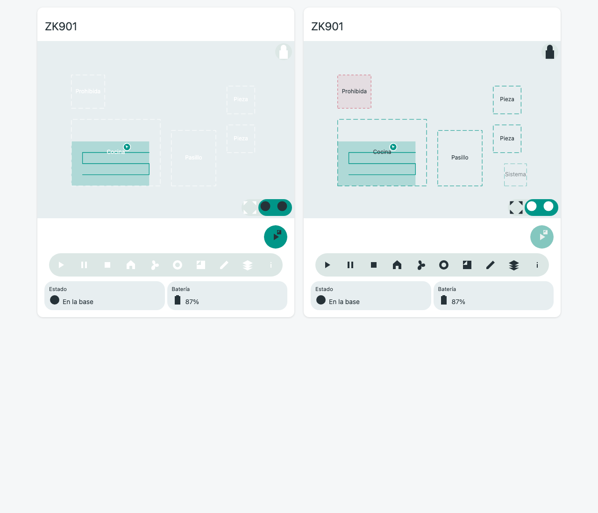
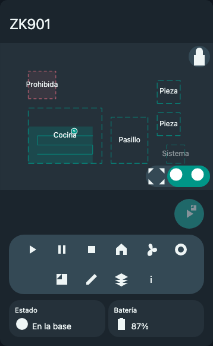

# Recuperación del frontend comunitario — 0.5.0

La card de producción hereda `CommunityMapCard`, recuperada del componente principal de Piotr Machowski en el commit `045c3ac946d4ef0a01201f306e9949643984a155`. Se mantienen MIT y la atribución del repositorio. [Inventario de archivos y hashes](community-source-inventory.json).

## Código recuperado

Se recupera el árbol `src/` de esa revisión dentro de `src/community/`, excepto su editor de configuración: se conserva el selector existente de entidad ZK901 y título. El componente principal heredado mantiene la estructura de `ha-card`, superficie de imagen, capa SVG, navegación, bloqueo, controles, iconos, menús, tiles y notificaciones.

`src/zk901-card.ts` es un adaptador sobre esa clase. Su `render()` prepara el estado ZK901 y delega en `super.render()`. La raíz de 0.2.0 fue sustituida; su estado de transacciones y editor persistente se conserva en un controlador sin otro renderer de tarjeta ni otro motor de pan/zoom.

## Cambios frente a la base

| Adaptación | Motivo |
| --- | --- |
| Nombres de elementos y eventos propios | Convivencia con la card comunitaria instalada, sin registrar de nuevo `pinch-zoom` o `xvmc-*`. |
| Visibilidad protegida de los miembros usados por el adaptador y tres hooks de contenido/acciones | Reutilizar el componente principal por herencia manteniendo su composición. |
| Imagen SVG local y tres puntos de transformación generados | Representar pose, recorrido y cobertura con la API existente, sin cámara ni calibración manual. |
| Room con activación adaptada y etiquetas accesibles | Seleccionar IDs persistidos y abrir el editor con las validaciones ZK901. Los tipos prohibidos y de sistema no se transforman en destinos de limpieza. |
| Controles conectados a servicios existentes y estado pendiente/deshabilitado | Preservar multizona en una operación, pausa/continuación, intensidad, errores e incertidumbre sin reenvíos automáticos. |
| Paneles de zonas, edición, capas e información | Mantener las funciones propias sin ocupar permanentemente la vista de uso diario. |
| Variables de contraste y tipo de línea | El fondo generado no tiene los colores de un raster LiDAR; preservar legibilidad en temas claro y oscuro. |
| Trigger nativo de botón para `ha-dropdown`, teclado y nombres accesibles en iconos, menús y zonas | Conservar la operabilidad sin depender de ratón o de interpretar iconos. |
| Cancelación del tracker y observador al desconectar; limpieza de listeners de editor | Evitar recursos retenidos en recargas y vistas que se desmontan. La matemática y las interacciones del motor de navegación se conservan. |
| Puente de tipos para las versiones 6/8 de la librería WebSocket | Compatibilidad del código de traducción original con los tipos de la conexión compartida; no se crea otra conexión. |

Se normalizaron únicamente espacios finales y líneas vacías de cierre que marcaba la revisión del diff; el inventario registra también esas diferencias de bytes.

Las funciones genéricas no soportadas por el robot no se generan en la configuración interna. No se expone limpieza por punto seleccionado, rectángulos temporales, rutas dibujadas, repeticiones ni otras marcas.

## Backend

Comparado con `ebdbda2`, todos los archivos Python, servicios y traducciones de `custom_components/liectroux_zk901/` permanecen idénticos. Solo se actualiza `manifest.json` de 0.4.0 a 0.5.0 para identificar la distribución conjunta. No hay migración de entidades, credenciales, datos de zonas o almacenamiento de recorridos.

La captura autónoma de 20 segundos y su API opcional de trayectoria permanecen iguales. El frontend no consulta el robot ni implementa un protocolo alternativo.

## Verificación

- 101 pruebas Python del backend, API, actualizador y paquetes.
- Flujos de navegador existentes adaptados al nuevo acceso a paneles: controles, multizona, CRUD, campos opacos, revisión, guardado retenido, conflictos, incertidumbre, varias cards/pestañas, reconexión y permisos.
- Pruebas de coordenadas contra la transformación afín original, imagen determinista ante cambios de timestamps y selección de capas.
- Zoom, bloqueo, pellizco táctil y actualización de pose conservando el encuadre.
- Arrastre de vértices sin escrituras al backend, deshacer y protección del borrador al cambiar de panel.
- Historial con 30.000 puntos y 30.000 celdas: una imagen local, capas interactivas acotadas, una suscripción y liberación de URLs al retirar la card.
- Referencia y adaptación montadas juntas, con datos idénticos y nombres de elementos originales presentes.

Las previews usan un backend y componentes nativos HA simulados. Son comprobaciones de software y composición, no capturas de una instalación real ni evidencia de ejecución física.

## Comparación visual

Referencia recuperada a la izquierda y adaptación ZK901 a la derecha. Ambas usan la misma imagen de telemetría; el contraste y la representación de objetos de sistema/prohibidos son adaptaciones propias.

La captura de selección y las vistas de edición se generan con `npm run test:browser`, en el directorio temporal `zk901-community-preview/`. Las diferencias de iconografía de las previews corresponden al sustituto de componentes HA usado por las pruebas; en la instancia se usan los componentes e iconos nativos.

## Aceptación pendiente en la instancia

Después de actualizar y reiniciar, comprobar carga, tema, menús, gestos y selección sin enviar movimientos. La limpieza completa, la ejecución física multizona y el diagnóstico de las terminaciones prematuras siguen pendientes del operador; esta entrega no cambia sus comandos ni afirma resolverlas.
